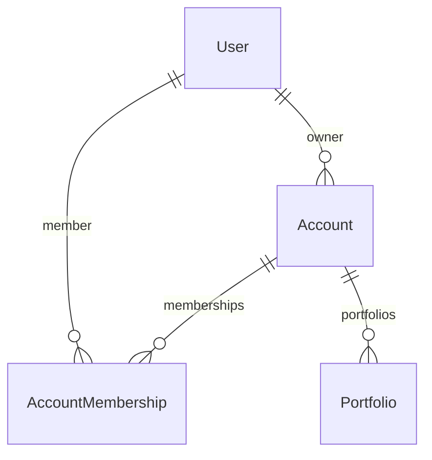

# ARCH-002 — Identités, comptes et propriété des portfolios

- Version de proposition : **0.1 — 18 octobre 2026** (Africa/Douala).
- Statut : **PROPOSITION À EXAMINER — NON APPROUVÉE**.
- Référence observée : `feature/auth-001`, commit **`2ff4fc1`**.
- Emplacement de travail : `feature/port-001`, après l’audit `d0afaf6`.
- Portée : spécifier les fondations de propriété nécessaires à PORT-001. Aucun modèle métier, migration, contrat OpenAPI exécutable ou mécanisme de collaboration n’est livré par ce document.

Cette proposition remplace les références antérieures à un ARCH-002 supposé approuvé. **Aucune relation Account/AccountMembership/Portfolio décrite ici n’est déjà validée.** Son approbation explicite doit précéder leur implémentation et toute nouvelle migration PORT-001. La PR nº 1 n’est pas fusionnée par cette démarche ; `main`, le CMS historique et `.local/` ne sont pas modifiés.

## 1. Faits vérifiés et sources

Les fichiers suivants ont été lus dans l’arbre Git **`2ff4fc1`**, et non déduits de la branche PORT-001 :

| Source AUTH-001 | État réellement implémenté |
|---|---|
| `backend/modules/identity/models.py` | `User(AbstractUser)` à UUID ; `username` supprimé ; e-mail comme identifiant ; prénom/nom ; `AuthSession` et `AuthenticationLimit` |
| `backend/modules/identity/managers.py` | E-mail normalisé par `strip().lower()` ; création utilisateur et superutilisateur |
| `identity/migrations/0001_initial.py` | Modèle utilisateur UUID initial, avec username et champs hérités de Django |
| `identity/migrations/0002_authenticationlimit_authsession_alter_user_options_and_more.py` | Contrôle/normalisation des e-mails existants, retrait de username, unicité et contrainte `Lower(email)`, tables de sessions suivies et de limitation |
| `identity/views.py`, `serializers.py`, `config/urls.py` | Inscription, login/logout, profil de session, CSRF et reset ; aucune gestion de compte ou de portfolio |
| `config/settings/base.py` | PostgreSQL, `AUTH_USER_MODEL=identity.User`, sessions Django/DRF, permissions fermées par défaut, cookies/CSRF et validateurs |
| `contracts/schemas/auth/session.v1.json` | Réponse `{user:{id,email,first_name,last_name},expires_at}` ; aucun compte ni rôle métier |
| `contracts/api/openapi.yaml` | OpenAPI 3.1 de santé CORE-001 uniquement ; l’API auth existe dans le code et sa documentation séparée, pas dans ce fichier OpenAPI |
| `backend/tests/test_authentication.py` | Inscription, sessions, CSRF, reset, unicité, limites et absence de fuite de privilèges testés |

**Absents d’AUTH-001** : Account, AccountMembership, Portfolio, provisioning de compte personnel, rôles métier de compte et contrats approuvés de composition/blocs/expérience. Les groupes et permissions Django présents sur User ne constituent pas un modèle de compte propriétaire.

### Écart de la branche PORT-001 provisoire

La branche PORT-001 préexistante au nouveau ticket comporte déjà une migration `portfolios.0001_initial` et un Portfolio avec `owner → User`, slug globalement unique, type personnel/professionnel/entreprise, brouillon/privé et suppression logique. Elle **ne fait pas partie de la référence AUTH-001** et ne prouve aucune approbation d’architecture.

Son historique doit être préservé. Ses champs et sa migration ne doivent pas être réécrits ni supprimés pour faire apparaître une installation neuve conforme. Une évolution additive et contrôlée sera nécessaire après approbation (§ 8).

## 2. Décisions structurantes proposées

Toutes les décisions **P01–P10** ci-dessous sont nouvelles et soumises à approbation.

| Réf. | Proposition | Conséquence |
|---|---|---|
| P01 | User reste l’identité d’authentification ; Account devient l’espace propriétaire | Les sessions continuent d’identifier un User ; les ressources métier appartiennent à Account |
| P02 | Un seul compte personnel par utilisateur, non transférable et non convertible en compte collaboratif | Un utilisateur peut avoir plusieurs portfolios sans multiplier ses comptes personnels ; les futurs espaces collaboratifs restent distincts |
| P03 | `Account.owner → User` est l’unique source de propriété du compte | Aucun rôle `owner` concurrent dans Membership ; un administrateur de compte n’est pas son propriétaire |
| P04 | Une Membership relie un User à un Account, avec rôle et activation | Le propriétaire possède une adhésion active `admin` ; les autres rôles restent réservés aux futurs comptes collaboratifs |
| P05 | `Portfolio.account → Account` est l’unique référence de propriété métier | Ni `Portfolio.owner → User` ni une Membership ne doivent devenir une seconde source d’autorité |
| P06 | Provisioning atomique du compte personnel à l’inscription, et rattrapage contrôlé pour les identités existantes | L’inscription reste sans connexion automatique ; aucun compte orphelin ni inscription partielle en cas d’erreur |
| P07 | Slug unique par Account, y compris parmi les portfolios supprimés logiquement | Deux comptes peuvent choisir le même slug ; une suppression ne libère pas immédiatement le nom |
| P08 | Version entière et préconditions de mutation pour Portfolio | Une écriture concurrente ancienne est refusée ; aucune perte silencieuse de modification |
| P09 | Gestion, visibilité et publication restent séparées | Archiver/restaurer/dupliquer ne publie rien ; PORT-001 reste privé et en brouillon |
| P10 | Les nouveaux comptes collaboratifs, invitations, transferts et API de membres restent désactivés dans PORT-001 | Le schéma prépare la collaboration, sans livrer le produit collaboratif |

## 3. Relations proposées

Le diagramme exprime les cardinalités relationnelles générales, incluant les futurs espaces collaboratifs. La règle métier impose **exactement un Account personnel provisionné par User**, et un nombre quelconque de portfolios dans cet espace. La contrainte SQL garantit « au plus un personnel » ; le provisioning et le rattrapage garantissent « au moins un » sur les chemins supportés. Une FK simple ne garantit pas à elle seule l’existence d’un enfant pour chaque User.

### 3.1 User — existant, conservé

- UUID, e-mail, hachage, prénom/nom, indicateurs Django et dates restent inchangés.
- Aucun champ Account dans le modèle utilisateur ; aucune FK inverse obligatoire créant une dépendance circulaire.
- `is_staff`, `is_superuser` et les permissions Django ne donnent aucun accès implicite aux portfolios d’autrui via l’API normale.
- Un utilisateur inactif reste refusé par l’authentification existante. Sa désactivation ne supprime pas les ressources ni l’historique de propriété.

### 3.2 Account — proposé, module `accounts`

| Champ proposé | Type / règle |
|---|---|
| `id` | UUID primaire, stable, généré indépendamment de l’UUID User |
| `kind` | `personal` ; valeur `collaborative` réservée à un ticket ultérieur |
| `owner` | FK obligatoire vers `settings.AUTH_USER_MODEL`, `on_delete=PROTECT` |
| `name` | Texte 1–100 caractères ; valeur personnelle neutre « Mon espace », sans recopier l’e-mail ou le nom du User |
| `is_active` | Booléen, vrai initialement ; aucun endpoint de fermeture/suspension dans PORT-001 |
| `created_at`, `updated_at` | Dates UTC |

Contraintes SQL proposées : PK UUID, FK propriétaire, domaine de `kind`, et unicité conditionnelle de `owner` lorsque `kind='personal'`. Cette dernière autorise à terme un User propriétaire de plusieurs espaces collaboratifs tout en lui interdisant deux espaces personnels.

Règles de service : propriétaire et type du compte personnel immuables ; création/recherche exclusivement à partir de l’utilisateur authentifié ; aucun identifiant Account accepté librement dans le formulaire de création d’un portfolio. Aucun compte collaboratif n’est créable par les services publics de PORT-001.

Le refus de suppression physique du propriétaire protège les comptes et leurs portfolios. La fermeture de compte, l’effacement d’identité et la rétention exigent une politique ultérieure ; aucune cascade destructive n’est introduite dans PORT-001.

### 3.3 AccountMembership — proposé, module `accounts`

| Champ proposé | Type / règle |
|---|---|
| `id` | UUID primaire stable |
| `account` | FK Account, `on_delete=CASCADE` pour une éventuelle purge de compte expressément autorisée hors PORT-001 |
| `user` | FK User, `on_delete=PROTECT` |
| `role` | `admin`, `editor`, `viewer` ; seul `admin` du propriétaire personnel est provisionné dans PORT-001 |
| `is_active` | Booléen, vrai initialement |
| `created_at`, `updated_at` | Dates UTC |

Contraintes SQL proposées : unicité **inconditionnelle** `(account, user)`, FK obligatoires, domaine de rôle. Une adhésion désactivée est réactivée sur la même ligne plutôt que dupliquée.

Invariants transversaux :

1. Le propriétaire de chaque compte possède une Membership active `admin`.
2. Un compte personnel ne possède aucune Membership d’un autre User.
3. La Membership du propriétaire personnel ne peut être supprimée, désactivée ou rétrogradée par une opération normale.
4. Un rôle `admin` ne transfère jamais la propriété `Account.owner`.

Ces invariants impliquent plusieurs lignes/tables : **ils ne peuvent pas être présentés comme garantis par une simple `CheckConstraint` Django**. Ils seront imposés par les services transactionnels, les permissions et les tests, avec verrouillage du compte lors d’un changement d’adhésion. PORT-001 n’exposera aucun endpoint de changement d’adhésion. Des triggers ou une défense SQL supplémentaire restent une décision ultérieure si des écritures directes doivent être supportées ; aucun trigger n’est supposé existant.

Un état incohérent détecté après provisioning doit échouer sans ouvrir l’accès : pas de réparation silencieuse d’un propriétaire erroné ou d’une adhésion explicitement désactivée. Le rattrapage ne crée que les éléments absents dont la cohérence est démontrable.

### 3.4 Portfolio — proposé, module `portfolios`

| Champ proposé | Type / règle |
|---|---|
| `id` | UUID primaire stable, conservé pour les instances provisoires existantes |
| `account` | FK Account obligatoire, `on_delete=PROTECT`, propriétaire métier unique |
| `name` | Texte après trim, 3–100 caractères — règle nouvelle proposée, reprenant la limite de l’implémentation provisoire |
| `slug` | Texte ASCII normalisé en minuscules, 1–110 caractères, segments alphanumériques séparés par des tirets |
| `description` | Texte facultatif, maximum 500 caractères |
| `management_state` | `active` ou `archived`, indépendant de la suppression |
| `publication_state` | `draft` initialement ; `published` réservé au futur ticket de publication |
| `visibility` | `private` initialement ; aucune activation de `public` dans PORT-001 |
| `deleted_at` | Date nullable de suppression logique ; aucune suppression définitive |
| `version` | Entier positif 64 bits, 1 à la création ; incrément après mutation effective |
| `source_template_id`, `source_template_version` | Références textuelles nullable, les deux absentes pour un portfolio vierge ; les deux présentes ou les deux nulles |
| `initial_theme_id`, `initial_theme_version` | Référence obligatoire vers une définition de thème validée/versionnée ; valeur par défaut à définir dans le futur contrat thème |
| `created_at`, `updated_at` | Dates UTC ; identifiants, dates et état privé des instances existantes préservés lors de la transition |

Contraintes SQL proposées : FK Account, unicité **`(account, Lower(slug))`** non filtrée par `deleted_at`, version ≥ 1, domaine de gestion, présence conjointe des deux références template. Dans PORT-001, garder les protections SQL existantes « brouillon uniquement » et « privé uniquement », adaptées au nom `publication_state` si le champ est renommé. Leur levée nécessitera une migration de publication distincte.

La syntaxe/longueur du slug et des textes seront validées côté API et modèles ; les contraintes SQL de non-vacuité/longueur/syntaxe nécessaires seront précisées dans le plan de migration approuvé. Les références thème/template ne pointent pas vers des tables inexistantes : cohérence de forme via SQL, résolution de version via schémas et registre serveur validé. Aucun JSON libre ne sera ajouté pour contourner l’absence de contrat.

`portfolio_type` de l’ancienne branche ne désigne pas le type d’Account. Il n’est pas requis par le nouveau parcours ; sa conservation interne pour compatibilité est proposée jusqu’à décision explicite de retrait, sans nouveau champ visible obligatoire.

## 4. Propriété et autorisations proposées

### PORT-001 : compte personnel uniquement

Pour chaque requête métier, vérifier `request.user.is_authenticated`, son activité et l’activité de l’Account, puis :

- `account.kind == personal` ;
- `account.owner_id == request.user.id` ;
- une Membership active `admin` entre ce compte et ce User ;
- `portfolio.deleted_at IS NULL` pour tout accès normal à un portfolio.

La liste et le détail utilisent le même filtre propriétaire. Une consultation d’un UUID étranger, inconnu ou supprimé répond **404 identique**, sans nom de compte ni indication d’appartenance. Aucune recherche globale préalable suivie d’une permission seulement côté frontend.

Le client ne peut ni assigner/changer `account`, `owner`, Membership, état de publication, visibilité ou références de template à sa convenance. En MVP, le compte personnel est sélectionné côté serveur. Un futur sélecteur de compte devra vérifier l’appartenance avant d’utiliser son UUID ; ce sélecteur n’est pas une fonction PORT-001.

Une Membership seule ne suffit pas à autoriser un espace collaboratif tant que sa politique n’est pas activée par un ticket distinct. Les futurs rôles admin/editor/viewer serviront à distinguer administration, modification et lecture, mais aucune invitation, gestion d’équipe, transfert ou activation des comptes collaboratifs n’est livrée ici.

Toutes les mutations restent protégées par session et CSRF. Les caches et sélections frontend ne sont jamais une preuve d’autorisation. Les réponses privées restent sans cache et les journaux ne contiennent ni secrets, ni corps de formulaire, ni liens reset.

## 5. Provisioning d’un compte personnel — proposition

Un service `accounts.ensure_personal_account(user)` assurera un provisioning idempotent, sans se baser sur un e-mail fourni par le client :

1. Transaction PostgreSQL ; verrou de la ligne User, puis de l’Account concerné lorsque présent. Tous les chemins supportés adoptent le même ordre de verrouillage.
2. Rechercher le compte personnel via `owner=user` et `kind=personal` ; créer s’il est absent. La contrainte conditionnelle reste l’arbitre en cas de concurrence.
3. Créer la Membership `admin` active manquante lorsque le compte est cohérent. Refuser une incohérence ou désactivation préexistante, sans la masquer.
4. Retourner le même Account lors d’un second appel ; ne créer ni portfolio ni contenu initial.

**Nouvelles inscriptions** : après approbation et installation du module accounts, étendre la transaction existante de RegisterView pour englober User + Account + Membership. La réponse 201 et le schéma de session ne changent pas ; aucune connexion automatique. Une panne de provisioning annule toute l’inscription. Le traitement des `IntegrityError` distinguera le doublon d’e-mail des erreurs de compte pour ne pas présenter toute erreur comme une adresse déjà utilisée.

**Utilisateurs existants et commandes d’administration** : provisioning de rattrapage par UUID, sans modifier User. Le service sera aussi appelé explicitement sur un chemin d’entrée SaaS authentifié sans effet secondaire GET, par exemple avant la première mutation métier, pour les identités créées par une commande Django hors inscription. Un contrôle détectera les identités encore non provisionnées.

Les GET d’authentification et de lecture n’auront pas d’effet secondaire de création de compte. Une identité administrative non provisionnée pourra s’authentifier normalement, puis être provisionnée par le service explicite avant usage métier. « Un compte par utilisateur » est donc une garantie du cycle de provisioning après rattrapage et des chemins supportés, non une fausse assertion de contrainte SQL universelle sur toute écriture brute de User.

Les signaux implicites `post_save(User)` et une importation du module accounts dans le manager identity ne sont pas proposés : ils compliqueraient les migrations historiques, les fixtures et les dépendances circulaires. Le service et ses points d’appel seront explicites et testables.

## 6. États et concurrence — propositions PORT-001

- Création vierge : active, draft, private, version 1 ; référence thème par défaut ; aucune référence template ni ressource publique.
- Modification : active uniquement ; UUID et Account immuables ; champs autorisés name/slug/description ; aucun changement implicite de publication.
- Duplication : source active seulement, même Account, nouvel UUID/slug, active/draft/private/version 1 ; métadonnées autorisées et thème compatible seulement. Aucune publication, URL publique, page, média ou animation copiée. La version et les dates de la source restent inchangées ; sa précondition vérifie seulement que les métadonnées lues correspondent à la version attendue.
- Archivage : active → archived ; lecture limitée conservée, modification et duplication refusées.
- Restauration : archived → active ; état de publication conservé, jamais de publication déclenchée.
- Suppression : confirmation explicite, `deleted_at` renseigné ; cible active ou archivée ; exclue de toutes les routes normales. Ni restauration d’un supprimé ni purge n’est disponible.

Le slug peut changer sans modifier l’UUID ni les références internes. PORT-001 ne crée aucune URL publique. Les futurs domaines/publications devront résoudre un portfolio par UUID et traiter les changements de slug dans leur propre contrat.

Les slugs automatiques partent du nom ; une collision peut produire un suffixe généré avec tentatives bornées. Un slug fourni explicitement qui existe dans le même Account répond 409. Le service traite les collisions via `IntegrityError` ciblé dans un bloc atomique/sauvegarde, jamais uniquement par une vérification préalable. Un nom valide dont le slug généré est vide utilisera une base neutre avec suffixe, sans générer de fausse donnée personnelle. La réservation des slugs supprimés s’applique aux deux chemins.

Le contrat REST final sera écrit dans OpenAPI **avant** l’implémentation. Proposition : chemins sans slash final, session AUTH-001 inchangée, ETag fort `"portfolio:<uuid>:<version>"` sur le détail et les réponses de mutation, `If-Match` obligatoire pour PATCH, duplication, archivage, restauration et DELETE. Absent : 428 ; ancienne version : 412 ; slug en collision ou état incompatible : 409 ; saisie invalide : 400. Aucun `If-Match: *` pour contourner le contrôle de version.

Dans une transaction : sélectionner la ressource avec le filtre d’autorisation, verrouiller sa ligne, vérifier la version et l’état, appliquer puis incrémenter. Une requête étrangère doit rester 404 avant toute comparaison de version. Les échecs ne modifient pas les dates, la version ou la publication. Un retry obsolète est refusé et ne doit pas écraser un travail récent.

## 7. Séparation des données et personnalisation — périmètre proposé

Les références d’origine template et de thème ne contiennent pas les données du designer. Elles ne sont pas une FK simulée vers un catalogue absent. PORT-001 devra définir des schémas versionnés pour la description des templates et des thèmes ; seule la création vierge sera activée.

Contenu, composition, thème/personnalisations visuelles et expérience/animations resteront des espaces distincts. Aucune structure arbitraire de blocs ou d’animation ne sera déclarée « conforme à ARCH-002 » avant définition de son propre schéma. Les contrats détaillés de blocs, héritage de page projet et Experience Builder restent à spécifier ; ils ne sont pas déjà présents dans AUTH-001.

Une mise à jour de template ne devra jamais écraser silencieusement les personnalisations d’une instance, et un changement de thème ne devra pas supprimer son contenu. Ce sont des exigences de compatibilité futures, pas des moteurs implémentés ici. Pas de GSAP/Three.js, catalogue, instanciation de template ou édition avancée dans cette phase.

## 8. Compatibilité et séquence de migration envisagée — non exécutée

### 8.1 Référence AUTH-001

- Ne modifier ni rejouer comme nouveau format `identity.0001` / `identity.0002` ; préserver `AUTH_USER_MODEL`, UUID, e-mails, hachages, groupes et permissions.
- Ne changer ni sessions stockées, secret Django, noms de cookies, règles CSRF, token reset, suivi AuthSession ou compteurs d’abus. Aucune déconnexion globale ni réinitialisation de mot de passe requise par l’ajout d’Account.
- Garder le contrat `session.v1` strict : pas d’ajout de `account` ou rôle à la réponse existante. Un éventuel endpoint de contexte Account sera distinct et documenté après approbation.
- Nouveau module `accounts` : migration de schéma dépendant explicitement de `identity.0002`, puis provisioning de rattrapage contrôlé. Aucune dépendance inverse depuis une ancienne migration identity.
- Distinguer contraintes locales SQL et invariants transversaux transactionnels : aucune prétendue garantie inter-table inexistante.

### 8.2 Branche PORT-001 déjà dotée de `portfolios.0001`

Après approbation, prévoir une transition en plusieurs opérations/migrations nouvelles :

1. Inspecter l’état du schéma et établir un protocole de sauvegarde SaaS avant toute base non jetable. Ne lire aucune donnée du CMS ou de `.local/`.
2. Créer Account/Membership, puis provisionner les comptes personnels des utilisateurs existants de façon déterministe et idempotente. Ne copier que les UUID de rattachement ; pas d’e-mail, nom, secret ou contenu dans les comptes ou preuves.
3. Ajouter `Portfolio.account` temporairement nullable et les nouveaux champs avec valeurs de compatibilité. La transition dépendra de `accounts` provisionné et de `portfolios.0001` ; les numéros exacts resteront à générer après approbation.
4. Rattacher chaque portfolio provisoire au compte personnel de son `owner` existant, **y compris les supprimés**, sans changer UUID, contenu, dates ou suppression. Les rattachements ambigus bloquent ; aucun transfert entre utilisateurs déduit du slug ou de l’e-mail.
5. Précontrôler les slugs existants face à la nouvelle syntaxe et aux comptes. Une collision ou valeur incompatible doit être signalée sans exposer les valeurs ni corriger silencieusement des références. Ne pas normaliser aveuglément d’anciens slugs.
6. Ajouter la contrainte d’unicité par Account et les contraintes d’état/version/références après vérification ; supprimer ensuite l’ancienne unicité globale. Rendre `account` obligatoire.
7. Faire basculer les services vers `account`, arrêter l’ancien chemin `owner → User`, puis retirer l’ancienne FK via une étape de contraction séparée. Pendant l’expansion, `owner` n’est qu’un champ de transition contrôlé, jamais une autorité concurrente.

Aucun serveur utilisant l’ancien modèle de propriété ne doit continuer d’écrire pendant le rattachement et la bascule. Pour le développement natif : arrêter Django/studio, sauvegarder si la base contient des données à conserver, migrer puis redémarrer la version compatible. Une bascule sans interruption en production nécessiterait un plan de double compatibilité distinct ; elle n’est pas revendiquée.

Une installation depuis zéro exécuterait les migrations historiques puis les nouvelles. Aucune fusion automatique des migrations ni suppression du schéma provisoire. Les migrations de données utilisent les modèles historiques et la connexion de migration, pas le rôle runtime. Le rôle de test garde sa base séparée et ses privilèges actuels.

Cette transition décrit une **évolution de schéma et de rattachement SaaS**. Elle n’autorise pas à migrer des données personnelles réelles sur ce poste/cloud ni à importer le CMS : toute exécution non synthétique attend un périmètre et une sauvegarde explicites.

Retour arrière : envisager une restauration de sauvegarde cohérente pour la contraction. Une fois le même slug permis dans deux comptes, revenir naïvement à l’unicité globale peut échouer. Ne promettre ni migration inverse universelle ni transfert personnel/collaboratif réversible sans traitement dédié.

## 9. Contrôles requis après approbation

| Domaine | Preuves attendues avant validation PORT-001 |
|---|---|
| Provisioning | Un personnel et une Membership pour un User ; appels répétés et concurrents ; rollback d’inscription si erreur ; rattrapage sans toucher aux UUID/hachages |
| Propriété | Deux Users et plusieurs portfolios ; UUID étranger 404 ; compte ou owner injecté refusé ; adhésion désactivée refusée ; compte collaboratif inaccessible dans le MVP |
| SQL | Deux personnels du même owner refusés ; Membership dupliquée refusée ; slug partagé entre comptes accepté et collision même compte refusée, y compris sous concurrence |
| États/version | Archivage/restauration, suppression confirmée, archives non modifiables, préconditions 428/412, brouillon/privé préservés pour toutes les opérations |
| Migration | Chemin AUTH seul vers nouveaux modèles et chemin depuis portfolios.0001 ; comptes utilisateurs/portfolios synthétiques existants ; supprimés conservés ; incompatibilité de slug bloque sans perte |
| AUTH-001 | Réinscription, login/logout, CSRF, expiration, reset/révocation et session.v1 strict, sessions déjà ouvertes conservées |
| Frontend | Aucun contenu inter-comptes ; gestion des conflits ; routes privées ; desktop/mobile, clavier, focus et dark mode |
| Systèmes | PostgreSQL 17 réel ; rôles minimaux ; migrations natives Windows PowerShell ; aucune suppression de l’historique ni secret dans les fixtures |

## 10. Examen demandé avant toute implémentation

L’approbation doit porter sur P01–P10, en particulier :

1. **Compte personnel unique, propriétaire immuable**, distinct de l’identité User et des futurs comptes collaboratifs.
2. **Propriété canonique sur Account.owner**, adhésion admin obligatoire sans rôle owner redondant, contrôles inter-tables assurés par les services.
3. **Provisioning atomique à l’inscription + rattrapage**, sans modifier le contrat de session ni introduire de signaux cachés.
4. **Portfolio rattaché à Account et slug réservé par compte**, même après suppression logique ; compatibilité avec les UUID existants.
5. **Préconditions de version et séparation des états**, publication toujours manuelle et désactivée dans PORT-001.
6. **Évolution des migrations provisoires sans réécriture**, arrêt des anciennes écritures pendant la bascule et tests synthétiques avant toute base à conserver.

### Vérification effectuée dans cette phase documentaire

Lecture des modèles, managers, vues, serializers, réglages, schéma de session, OpenAPI et migrations de l’arbre AUTH-001 `2ff4fc1`, puis comparaison avec la migration Portfolio provisoire actuelle. L’état `identity.0002` a également été reconstruit en mémoire avec `MigrationLoader(None)` : UUID, retrait de username, unicités de l’e-mail, modèles de session/limitation et absence d’Account/Membership/Portfolio vérifiés, sans connexion PostgreSQL. Les 11 sources historiques et 4 empreintes de fixture restent conformes. La compatibilité décrite est **une analyse structurelle**, pas une exécution des migrations proposées : ces migrations n’existent pas et n’ont pas été créées. Les tests de préparation précédents sur l’ancienne branche PORT ne valident pas cette architecture.

**Point d’arrêt : attendre l’examen et l’approbation explicite de cette spécification. Aucun modèle, aucune nouvelle migration ni fonctionnalité PORT-001 ne doit être commencé sur la seule présence de ce document.**
